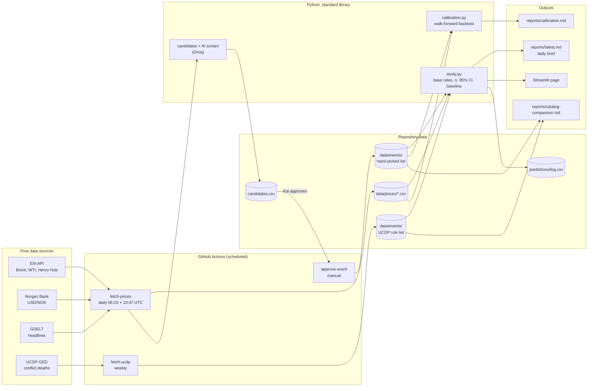

# Huginn & Muninn

What did prices do after events like this one? Huginn & Muninn collects market-moving events, finds comparable past events, and reports what prices did afterwards as a historical base rate:

> 5 trading days: in 21 comparable events, Brent rose in 11 (52%, 95% CI 32-72%). Median +1.0%, range -6.5% to +22.2%. Baseline: 2003 non-overlapping 5-day windows, 1057 rose (53%, 95% CI 51-55%).

It reports history. It does not forecast, recommend or trade; the reader makes the decisions.

**Live page:** [kaiju77.github.io/huginn-muninn](https://kaiju77.github.io/huginn-muninn/): the daily brief, the backtest, the live prediction log and the crisis-list comparison, rebuilt after every scheduled run.

## What it does today

- **Event study.** Middle East conflict onsets since 1988 against Brent, WTI, Henry Hub gas and USD/NOK, at 5, 20 and 60 trading days. Every figure has n, a Wilson 95% CI, a range and a normal-period baseline.
- **Daily brief** ([`reports/latest.md`](reports/latest.md)). Price moves, base rates for recent events, same-day headlines, and suggested new events found by a keyword screen and an AI screen. A person approves each new event.
- **Honest scoring.** A walk-forward backtest ([`reports/calibration.md`](reports/calibration.md)) "predicts" each past event from earlier events only and scores it with the Brier score against the baseline. So far the event base rates are mostly no better than the baseline, and the report says so.
- **Live prediction log** ([`reports/prediction-log.md`](reports/prediction-log.md)). Each new crisis is logged once with only the prices known that day, and scored when its horizon has passed. It cannot be backfilled.
- **Two crisis lists.** The hand-picked list is biased towards famous crises. A second list will come from a fixed rule on UCDP conflict-death data. The code is ready; the data is waiting for a UCDP API token (`UCDP_TOKEN`). [`reports/catalog-comparison.md`](reports/catalog-comparison.md) will then show how far the two lists agree.

## Method rules

1. **No look-ahead.** An event counts from the first close on or after the day it was public. News first seen at or after 12:00 UTC counts from the next day.
2. **Always n, 95% CI and range**, for the events and for the baseline. Fewer than 8 events gives no percentage.
3. **One event per crisis.** Follow-up events in the same episode are not counted as independent.
4. **Non-overlapping baseline windows.**
5. **Backtest before trusting a probability.**

Details and the decision log are in [`PROJECT_STATE.md`](PROJECT_STATE.md). Every review round and its fixes are in [`REVIEW.md`](REVIEW.md).

## Quick start

Python 3.12, standard library only (Streamlit is needed only for the page).

    python -m unittest discover -s tests          # all tests
    python scripts/event_study.py                 # base rates for every asset, printed
    python scripts/daily_report.py                # the daily brief -> reports/latest.md
    python scripts/backtest.py                    # is it right? -> reports/calibration.md
    python scripts/compare_catalogs.py            # hand-picked vs UCDP rule list
    pip install -r requirements-app.txt
    streamlit run app/streamlit_app.py            # interactive results page

Live fetches run in GitHub Actions with keys stored as repository secrets (`EIA_API_KEY`, `GROQ_API_KEY`, `UCDP_TOKEN`). The price files in `data/prices/` are committed, so everything above runs without keys.

## Architecture

Rules that hold everywhere: no look-ahead (an event counts from the first close on or after the day it was public), one event per crisis episode, and every probability comes with n, a 95% CI, a range and a normal-period baseline.

## Repository layout

| Path | Contents |
|---|---|
| `src/huginn_muninn/` | `study.py` (event study), `calibration.py` (backtest), `predictions.py` (live log), `candidates.py` and `ai_screen.py` (event screens), `ucdp_events.py` (rule-based onsets), `compare.py` |
| `scripts/` | Command-line entry points and fetchers |
| `data/` | Prices, event catalogs, candidates, news, prediction log |
| `reports/` | Generated reports |
| `.github/workflows/` | Scheduled fetches, tests, event approval, the public page |
| `tests/` | Unit and regression tests |

## Limits

- Few events (about 20 independent crises), so the intervals are wide.
- EIA prices arrive a few days late.
- Same-day headlines are context. They do not prove why a price moved.
- One category so far. Planned next: more event types (see [`ROADMAP.md`](ROADMAP.md) and `ideas.md`).

The repository also holds a parked ledger prototype from an earlier direction: [`docs/LEDGER_PROTOTYPE.md`](docs/LEDGER_PROTOTYPE.md).
